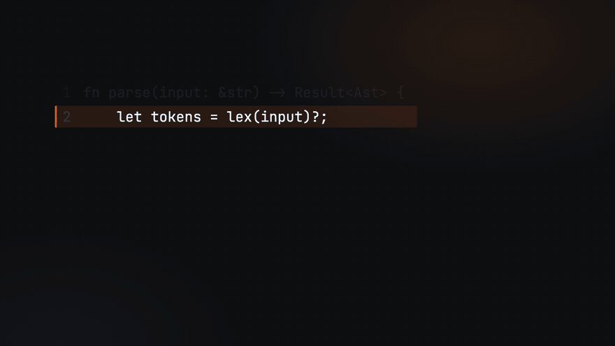

<div align="center">


# Tracewise

<a href="#install"></a>
<a href="docs/getting-started.md"></a>
<a href="docs/commands.md"></a>
<a href="UI.md"></a>
<a href="docs/editors.md"></a>
<a href="https://github.com/cmdworks/tracewise/actions/workflows/ci.yml"></a>

A flight recorder for your code.<br>
Who changed every line, when, and why — you, a coding agent, a script or git.<br>
Recorded. Explained. Reversible.

</div>

<br>

<div align="center">

<br><sub><a href="assets/demo.mp4">Watch it with sound</a> · short ones: <a href="assets/demo-cli.mp4">command line</a> · <a href="assets/demo-app.mp4">desktop app and menu bar</a> · <a href="assets/demo-editors.mp4">Zed and VS Code</a></sub>
</div>

<br>

```console
$ tracewise blame src/parser.rs
   1 01M6ZGP1763ZWNTNPSJSCEQVSB claude/s1  2026-11-09T06:42:12Z | fn parse(input: &str) -> Result<Ast> {   <- "handle empty input without panicking"
   2 01M6ZGP1763ZWNTNPSJSCEQVSB claude/s1  2026-11-09T06:42:12Z |     let tokens = lex(input)?;            <- "handle empty input without panicking"
   3 baseline                                                   |     build(tokens)   (git: you, 2026-11-09)
   4 baseline                                                   | }

$ tracewise why src/parser.rs:2
Line 2 in src/parser.rs changed by claude/s1 at 2026-11-09T06:42:12Z (01M6ZGP1763ZWNTNPSJSCEQVSB)
Why: handle empty input without panicking

$ tracewise undo --actor claude --since 1h     # take it all back; your own edits stay
```

Coding agents edit many files quickly, often several at once, and git only sees the result when someone commits. Tracewise fills the gap between commits, without touching your git history, and it works in a folder that is not a git repository too.

**On this page:** [What you get](#what-you-get) · [Install](#install) · [Quick start](#quick-start) · [Everyday use](#everyday-use) · [Coding agents](#coding-agents) · [Choose how much it watches](#choose-how-much-it-watches) · [Editors](#editors) · [Desktop app](#desktop-app) · [Sharing](#sharing-between-machines) · [Settings](#settings) · [Commands](#commands-at-a-glance) · [How it works](#how-it-works) · [Documentation](#documentation)

---

## What you get

<table>
<tr>
<td width="50%" valign="top">

**Record**
- 📝 every file change in a project, with its author and how sure Tracewise is
- 🤖 tells **Claude Code, Codex, Cursor, Gemini and Antigravity** apart from you, a script or git
- 🐚 captures edits from agent hooks, your shell (zsh, bash, fish, PowerShell, nushell), `git` and git apps, with a watcher for the rest
- 📁 works **with or without git**, in any folder or subfolder

**Explain**
- 💬 a **reason** for each change: agents give it before they edit, people add it later (or are asked in their editor)
- 🔍 `blame` and `why` show the story behind any line, also as it was at an earlier change
- 🏷️ small and whitespace-only changes get an automatic reason, and `log` folds runs of them into one line

</td>
<td width="50%" valign="top">

**Undo**
- ⏪ **undo** one change, everything an agent did in the last hour, or one whole task, and **redo** it
- 🕰️ **restore** any file to how it was at any point
- 🔒 optional **locks** keep two agents (or an agent and you) from editing one file at once

**Everywhere you work**
- 🧩 **editors**: [VS Code](editors/vscode) (and Cursor, Windsurf, Antigravity) and [Zed](editors/zed), showing blame on the line and who edited from where (`as via Zed`)
- 🖥️ a **desktop app** (preview) with a live timeline, file history, undo and health
- 🔄 optional **sharing between machines**, signed per device and optionally encrypted
- 🧪 a **GitHub Action** that verifies the history and adds a report to the job summary

</td>
</tr>
</table>

Also: a **hash-chained history** kept next to your project and not in your commits (`tracewise doctor --verify` finds any changed or missing record) · about **5 ms per agent edit** and **0% CPU** when idle · it **never blocks** git, your shell or an agent when something goes wrong.

---

## Install

<a href="https://github.com/cmdworks/tracewise/releases"></a>
<a href="LICENSE"></a>

| OS | Command line (binary) | Desktop app (UI, with the menu bar) |
|---|---|---|
<!-- downloads:start -->
| **macOS, Apple silicon** | [tracewise-0.0.1-beta-macos-arm64.tar.gz](https://github.com/cmdworks/tracewise/releases/download/v0.0.1-beta/tracewise-0.0.1-beta-macos-arm64.tar.gz) | [Tracewise 0.0.1-beta (arm64).dmg](https://github.com/cmdworks/tracewise/releases/download/v0.0.1-beta/tracewise-desktop-0.0.1-beta-macos-arm64.dmg) · preview |
| **macOS, Intel** | [tracewise-0.0.1-beta-macos-x86_64.tar.gz](https://github.com/cmdworks/tracewise/releases/download/v0.0.1-beta/tracewise-0.0.1-beta-macos-x86_64.tar.gz) | [Tracewise 0.0.1-beta (x86_64).dmg](https://github.com/cmdworks/tracewise/releases/download/v0.0.1-beta/tracewise-desktop-0.0.1-beta-macos-x86_64.dmg) · preview |
| **Linux** | planned (build from source: `cargo build --release`) | planned |
| **Windows** | planned | planned |
<!-- downloads:end -->

The desktop app needs the command line (it offers to install it on first start); its page is [UI.md](UI.md). All files are on the [releases page](https://github.com/cmdworks/tracewise/releases).

**Editor extensions** (they call the command line, so install it first):

| Editor | Extension | Get it |
|---|---|---|
| **VS Code**, Cursor, Windsurf, Antigravity | blame on every line, hover, status bar, your saves recorded, an optional "why?" box | build the `.vsix` from [`editors/vscode`](editors/vscode) (marketplace publishing is pending) |
| **Zed** | hover with who and why, your saves recorded, one-click reasons after a save | `zed: install dev extension`, then pick [`editors/zed`](editors/zed) |
| **Any editor with language-server support** | the same hover and save recording | point it at `tracewise lsp` |

Details for each: [editors](docs/editors.md).

**One line** — downloads the newest release, checks it, then runs `tracewise setup`, which asks how much to watch (agents, balanced or full) and sets everything up; no `sudo`:

```bash
curl -fsSL https://raw.githubusercontent.com/cmdworks/tracewise/main/scripts/install.sh | sh
```

Options go after `sh -s --`, for example `| sh -s -- --login yes --fish`:

| Option | |
|---|---|
| `--version <tag>` | a given release instead of the newest |
| `--preset agents\|balanced\|full` | how much to watch, instead of being asked |
| `--login yes\|no` | start the watcher at login |
| `--no-start` | do not start the watcher now |
| `--fish` | also bind fish (automatic when fish is your shell) |
| `--no-shell` | leave shell files alone |
| `--agents claude,codex,...` | hooks for coding agents in the repository you run it from |
| `--profile core\|full` | default profile |
| `--strict` | also install the strict sensor (asks for `sudo`) |
| `--archive <file>` | install from a downloaded archive |
| `--uninstall` | remove it all again; project histories stay |

**By hand** — download the archive for your Mac from the table above, then:

```bash
tar -xzf tracewise-*-macos-*.tar.gz && cd tracewise-*
./tracewise setup          # programs in ~/.tracewise/bin, one block in ~/.zshrc, the background watcher; no sudo
tracewise doctor --all     # in a new terminal: check the installation
```

**From source** (needs a current stable Rust from [rustup](https://rustup.rs)):

```bash
git clone https://github.com/cmdworks/tracewise && cd tracewise
cargo build --release
./target/release/tracewise setup
```

> [!NOTE]
> Release builds are not notarized yet. If macOS blocks them, clear the download flag first: `xattr -dr com.apple.quarantine .`. For the desktop app: drag it to Applications, then run `xattr -dr com.apple.quarantine /Applications/Tracewise.app` (or right-click it and choose Open). On first start it offers to install the command line if it is missing.

`tracewise` also answers to **`tw`**, **`trace`** and **`tracwise`** (the usual typo): every example below works with either.

---

## Quick start

```bash
cd your-project
tracewise init                      # start recording this folder (a git repository is not required)
tracewise agent install claude      # optional: hooks for an agent (claude, codex, cursor, gemini, antigravity)

# ...work as usual; edit files, let agents edit files...

tracewise log                       # what changed, by whom
tracewise why src/app.rs:42         # why this line looks the way it does
tracewise note --last "why"         # say why, after the fact
tracewise undo <change id>          # take one change back
tracewise capture                   # what is recording live, and how to change it
```

`init` records the current state of the project as a baseline. The history lives in `~/.tracewise/projects/<id>/`; the only thing added to your folder is a small `.tracewiseproject` marker with the project id. The first `init` prints a recovery secret once: keep it in a password manager.

---

## Everyday use

### See what happened

```bash
tracewise log                         # newest changes first
tracewise log --actor claude --since 2h
tracewise log --grep "parser"         # path or reason contains the text
tracewise log --group                 # grouped by task
tracewise log --md --session <id>     # one task as Markdown, for a review or a hand-off
tracewise show <change id>            # one change with its diff
tracewise status src/app.rs           # who holds a file, and who changed it lately
tracewise diff src/app.rs --since 1h  # what changed in the last hour, as a diff
```

`log` shows a run of old, minor edits (whitespace, a character or two) as one line; `--unfold` shows every row. Every command takes `--json`.

### Understand a line

```bash
tracewise blame src/parser.rs         # who last changed each line, and why
tracewise blame src/parser.rs --at <change id>   # as it was at an earlier change
tracewise why src/parser.rs:2         # the full story of one line
```

### Say why

```bash
tracewise note -m "fix the empty-input crash" --before src/parser.rs   # before editing
tracewise run -m "update dependencies" -- cargo update                 # around one command
mv parser.rs lexer.rs --note "the lexer is its own module now"         # sed, mv, cp, rm and tee take --note too
tracewise pending                     # changes that have no reason yet
tracewise note --last "rename the config keys"                         # after the fact, for all of yours
tracewise note <change id> "why"      # one change
```

For people this is never required. When you commit, the commit message becomes the reason of your changes that have none.

### Go back

Undo works on lines, not whole files: only the lines a change wrote are taken back, and later edits by others stay.

```bash
tracewise undo <change id>                     # one change
tracewise undo --actor codex --since 30m       # everything an agent did in the last half hour
tracewise undo --intent <intent id>            # one whole task
tracewise undo <change id> --dry-run           # show what would happen
tracewise undo --redo <undo id>                # changed your mind
tracewise restore src/app.rs --at <change id>  # put a whole file back as it was
```

An undo is itself recorded, so nothing is ever lost.

### Keep it healthy

```bash
tracewise status                # changes, locks, watcher
tracewise doctor                # checks this project; --all checks the installation
tracewise doctor --verify       # no record was altered or removed
tracewise doctor --gc           # pack stored versions; run now and then
tracewise ignore build/ '*.log' # stop recording paths (writes .tracewiseignore)
tracewise ignore --prune        # also remove the history already recorded for ignored paths
```

---

## Coding agents

Agents with hooks tell Tracewise exactly which file they are about to edit, in which session, and why, so their edits are credited **exactly** instead of guessed.

```bash
tracewise agent install claude      # also: codex, cursor, gemini, antigravity
tracewise agent status              # which agents are connected here
tracewise agent list                # built-in agents and adapter files
```

- **Reasons.** An agent declares its reason before editing (`tracewise note --why "…" --before <files>`, taught to it by an installed skill). Set `reasons.mode` to `enforce` and an agent without a reason is refused; the default `warn` lists its changes in `tracewise pending`.
- **Locks.** With the `coordination` profile, an agent that edits a file another holds is told to wait (`tracewise lock list`, `lock wait`, `lock release`).
- **Background work.** `tracewise jobs` lists what agents started in the background; `jobs --stop <id>` ends the attribution of later writes to it.
- **Any other agent** with a hook system works with a small adapter file, no rebuild needed: see [configuration](docs/configuration.md#adding-an-agent).
- A person is never forced: undo of a person's change by an agent is refused, and an agent cannot pose as you.

---

## Choose how much it watches

Pick one of three presets and switch at any time without losing history. What a preset does not see live is found by a quick scan on your next command and marked as likely.

| Preset | What records live | Background process |
|---|---|---|
| `agents` | agents (through their hooks) and editors | none |
| `balanced` | also the commands you type, and git | none |
| `full` | also a watcher for changes made by any program | one small watcher |

```bash
tracewise capture                   # the current preset and each layer, and anything that disagrees
tracewise capture list              # the presets
tracewise capture use balanced      # apply one (asks first; --dry-run shows what would change)
tracewise capture daemon status     # the watcher: start | stop | status
```

The presets are a data file, not code: add your own in `~/.tracewise/presets.toml`. Details in [configuration](docs/configuration.md#capture-presets).

---

## Editors

| Editor | What you get | Install |
|---|---|---|
| **VS Code**, Cursor, Windsurf, Antigravity | blame at the end of each line, a hover with the reason, a status bar item, your saves recorded, an optional "why?" box after a save | `editors/vscode` (marketplace publishing is pending) |
| **Zed** | hover with who and why, your saves recorded, a popup with one-click reasons after a save | `zed: install dev extension`, then pick `editors/zed` |
| any editor with language-server support | the same hover and save recording | point it at `tracewise lsp` |

Saved in an editor, a change says which one: the hover shows `as via Zed`, `tracewise log` shows `you (likely) via Zed`.

**Asking why in Zed.** After a save, a popup offers *Bug fix*, *Refactor*, *New feature*, *Same as last*, *Type my own…* (opens a small tab to write in) and *Skip*. You choose when it appears (`pause`, `every-save`, `interval`, `leave` or `manual`), the smallest change worth asking about, and files to skip. Changes too small to ask about get an automatic reason instead, shown in italics in the app.

```bash
tracewise editors zed --settings    # asks what you want, then prints, writes or opens the Zed settings
tracewise editors zed --apply       # the one-key task that asks in Zed's own terminal
```

Everything is in [editors](docs/editors.md).

---

## Desktop app

A Tauri app (preview) on the same history, with a **menu-bar icon** that shows whether Tracewise is recording (start and stop the watcher, the last change at a glance): a **live timeline** with the reason and editor for each change, **file history** with blame, **undo** by change, session or task, **projects**, **health** (protection level, who is credited, the capture preset), and settings. It runs the allow-listed `tracewise` commands as you and never loosens what Tracewise refuses. See [UI.md](UI.md) for the tabs, keys and building it.

---

## Sharing between machines

By default history stays on your machine. Sharing lets every clone of a project — your laptop, your desktop, your teammates — see the same history, through a git remote: each machine pushes signed batches under its own ref, so pushes never conflict, and the database is rebuilt from the batches (`tracewise doctor --rebuild`).

```bash
tracewise share init                # uses the project's own remote, hidden refs, level "summary"
tracewise share init --remote git@github.com:me/history.git --level full --encrypt
tracewise share push                # send this machine's new records
tracewise share fetch               # import everyone else's
tracewise share status
```

Levels (`off`, `summary`, `full`), encryption, key export and rotation: see [sharing](docs/sharing.md).

---

## Settings

Read from, strongest first: environment variables, the project's `.tracewiseconfig` (commit it to share settings), `~/.tracewise/config.toml`, built-in defaults.

```bash
tracewise config get                         # every setting and where its value comes from
tracewise config set reasons.mode enforce    # off | warn | enforce
tracewise config set --global profile.name full
```

| Setting | What it decides |
|---|---|
| `reasons.mode` | whether an agent without a reason is ignored, listed, or refused |
| `profile.name` | `core`, or `full`: adds locks, policy checks, the strict sensor and sharing |
| `capture.mode` | follows the capture preset (`full` with a watcher, `agents` without) |
| `storage.max_file`, `storage.secrets` | files over this size, or holding a secret, are recorded by hash only |
| `durability.level` | `full` (every record on disk before it is reported) or `normal` |
| `retention.commands` | how long recorded command lines are kept |

All of it in [configuration](docs/configuration.md).

---

## Commands at a glance

| Job | Commands |
|---|---|
| **Get started** | `init` · `setup` · `uninstall` · `status` · `doctor` |
| **Read history** | `log` · `show` · `blame` · `why` · `diff` |
| **Say why** | `note` · `run` · `pending` |
| **Go back** | `undo` (`--redo`) · `restore` |
| **Choose what records** | `capture` · `agent` · `editors` · `ignore` |
| **Team and coordination** | `share` · `lock` · `jobs` |
| **Settings** | `config` |

Every command has a short name (`tracewise l` is `tracewise log`) and the common options a short letter. About twenty commands in all; the ones that hooks, wrappers and editors call are listed in [entry points](docs/internals.md). The full list with every option: [commands](docs/commands.md).

---

## How it works

Four layers feed one history, and you choose which are on:

- **Agent hooks** report exactly what an agent does, with its reason.
- **Your terminal and git:** a shell hook, command wrappers (`sed`, `mv`, `cp`, `rm`, `tee`) and a `git` wrapper record what you type and mark branch switches as one change.
- **Editors:** the VS Code and Zed extensions record your saves and show the history on the line.
- **A watcher** (optional) records changes made by any program, and a **catch-up scan** finds anything the others missed.

Every record carries the hash of the one before it, so the history can be verified; batches shared between machines are signed per device. Details in [how it works](docs/how-it-works.md).

---

## Documentation

Read it as a website: **https://cmdworks.github.io/tracewise/** (searchable, with dark mode). The same pages:

| | |
|---|---|
| [Getting started](docs/getting-started.md) | Install, first project, agents, everyday commands |
| [How it works](docs/how-it-works.md) | How changes are captured, attributed, stored and undone |
| [Commands](docs/commands.md) | Every command, grouped by task (about 20; the ones other programs call are in [entry points](docs/internals.md)) |
| [Editors](docs/editors.md) | VS Code and Zed, the language server, asking why after a save |
| [Configuration](docs/configuration.md) | Profiles, capture presets, reasons, ignore rules, settings |
| [JSON output](docs/json.md) | The stable shapes scripts and editors can rely on |
| [Desktop app](UI.md) | Install the app, its tabs and keys, what it may do, building it |
| [Sharing](docs/sharing.md) | Sharing history between machines, optionally encrypted |
| [Contributing](CONTRIBUTING.md) | Building, testing, and how the repository is laid out |

---

## Status

Tracewise is young (0.x). The record format and the commands may still change between minor versions. Bug reports and ideas are welcome in [Issues](https://github.com/cmdworks/tracewise/issues); please report security problems privately as described in [SECURITY.md](SECURITY.md).

## License

[GNU GPL v3 or later](LICENSE). You may use, change and share Tracewise, but any version you distribute must stay open source under the same license.
